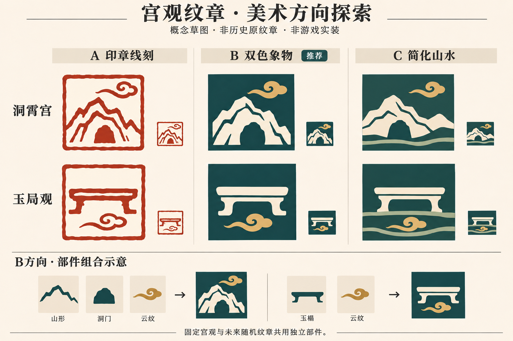

# 宫观与致仕纹章设计

状态：用户于2026-11-05选择B「双色象物」，本页记录美术方向、素材复用判断和未来组合约束；**尚未制作运行素材、接入纹章或实现随机生成**。具体宫观构图为待深化候选，不因选定B而视为全部定稿。历史题材及其证据边界只在[宫观纹章题材考证](../../research/song/retirement_coa/README.md)维护；退休玩法规则仍以[机制设计](retirement_design.md)为准。

## 目的与取舍

用少量明确的物象区分宫观，使纹章在人物面板、头衔卡和小尺寸列表中都能识别；保持原版中国纹章的图形语言，并使固定宫观与未来随机宫观共享素材。

曾比较三条路线：A「印章线刻」中国印章感强，但边框和细线挤占主体，小尺寸容易粘连；B「双色象物」以宽轮廓与少量镂空表现物件，容易染色、拆分和组合；C「简化山水」地域气氛强，但容易发展成小风景画，组合约束更复杂。用户选择B。A的印框可作为少数构图的配件，C的山水题材可转成独立物象，不沿用它们的整幅画法。

不把游戏纹章宣称为历史宫观原徽，不照搬现代景区标识，也不以绘制十六张整图作为素材交付方式。纹章不承担官品、名额、俸禄和官称的重复说明；同一宫观的不同任领档共用固定设计。

## 概念图与需要修正之处

这张AI生成图只保存方向比较，供后续美术讨论使用，不是运行纹理、宋代实物复原或已通过小尺寸验收的成品。B是选定方向；图中的底色明暗变化不采用，玉榻偏供桌、洞霄山形偏通用的问题仍须修正。底部组合示意只说明物件可以分层，不证明引擎已支持任意相减、镂空或图层混合。

## B的画面规则

- 一个主物象，占据中心；默认至多增加两类辅助物象。多峰、双鹿等重复实例仍须整体简洁。
- 以实心轮廓和少量宽镂空形成形体，细节服务于识别，不画写实阴影、高光、金属反射、渐变或仿旧噪点。
- 以两种主要颜色形成对比；背景之外原则上只用一种主体色，确有需要时增加一种辅助色。青绿、黛蓝、朱、赭与米白可作候选色系，具体原版色值和搭配尚未定稿，不将所有宫观锁为青绿金白。
- 统一轮廓力度、细节密度、留白与视觉重量；用物象和构图区分宫观，颜色只作辅助。不能依赖色差才能分清所有对象。
- 画面须预留四周余地，重要细节不贴边；不把头衔等级外框、冠饰或界面装饰烘焙进图案。
- 默认不加细小文字、完整宫观名或复杂篆文。印框是可选部件，不强制每个设计套框。
- 构图先按单色剪影判断，再看配色；须在真实28、44、88像素预览中分别检查轮廓、镂空和留白。概念图上的缩略图不能代替实际缩放。

## 素材拆分与复用单位

以能单独识别、方便摆放和染色的完整物件为单位。玉榻、经幢、碑石、旌节分别保持完整；山、洞门、云、水、帷与屋宇可按布局分层。山峰可重复排列成五峰，单鹿可镜像组成双鹿。云和水不能预先粘在主体贴图上。

龟蛇相缠等有固定关系的图形允许成为一个完整语义部件；不为追求拆分数量，把器物拆到每条腿或把所有动物强行拼装。完整语义部件仍能在不同底纹、配件与布局中复用。是否另做独立龟、蛇，由轮廓与复用价值决定。

需要同背景色覆盖来表现洞口时，须检验换色后的边缘和图层顺序，不以某一固定底色的色块冒充透明镂空。任意山形都能自动开洞、任意曲线都能与主体交织，均属未确认能力。

新增图案采用独立`tca_`命名及原生目录，匹配原版可染色纹章遮罩的轮廓语言；具体通道、DDS压缩、透明边缘与mipmap导出须在制作前核查同类原版文件。现有120像素人物特质图标不是纹章源图，不直接缩放充当纹章素材。

## 原版素材复用评估

本轮核对了原版文件名、实际贴图及部分组合定义；结论是美术适配判断，不代表这些素材已经接入或通过游戏显示验收。

- **可优先试组**：`ce_seal_pictorial_central_deer.dds`、`ce_seal_pictorial_vertical_deer.dds`、`ce_seal_pictorial_central_snake.dds`属于中国肖形印系列；可分别用于鹿与蛇题材。鹿可镜像，但姿态、留白和双鹿小尺寸表现仍须试排。
- **可直接作为候选配件**：`ce_seal_cloud.dds`、`ce_eastern_clouds.dds`、`ce_seal_frame.dds`、香炉印框两种版本，以及普通`ce_star_08.dds`。星形只作星象的设计表达，不冒称具体历史星图。印框、云与主体的笔触和粗细须一起审阅。
- **可试用但受构图限制**：`ce_waves_01.dds`、`ce_waves_02.dds`带较大矩形色区，不能当作透明水线直接叠放。须先检查通道染色、裁边与不同底色；不合适时新增短水纹部件。
- **不直接借作中国山形或玄武**：`ce_kamon_mountain.dds`在实形上带明显富士山式轮廓；`ce_kamon_turtle.dds`带日式龟纹特征，`ce_african_turtle.dds`带另一种地域造型。它们只提供简化程度参考，不能因文件名相符就用于嵩岳、天柱或龟蛇。
- **不以近似器物替代**：`ce_column.dds`与`ce_column_banner.dds`是柱及缠带柱，不直接充当中国经幢、御碑或旌节；`ce_clothes.dds`也不用于幞头与笏板。没有在本轮按名称检索中找到床榻、经卷等，不等于原版所有目录均已穷尽。
- **文字仅限候选**：原版有`ce_seal_name_shou_58fd.dds`可供致仕荣养意象试组；它是通用寿字，不是宋代致仕专徽。所需宫观名字在现有单字素材中不齐，不混拼同音异字补全。

拟补的部件优先级：先试排通用山峰／洞门与玉榻，确定B的线条和细节基准；再按正式采用题材评估经幢、碑石、旌节、屋宇、飘帷、龟蛇与短水纹。该清单是缺项候选，不是已批准逐项制作的资产清单；复用成功的原版物件不重复新绘。

## 固定宫观的候选构图

本节只维护美术安排；历史判断和等级见考证页同名条目。下列布局均未制作，不据此提高历史证据等级。山形是图形概括，不承诺复原某一峰的精确地貌。

- **嵩山崇福宫**：宽厚山体配上方云气，营造嵩岳与皇家宫观的稳重感；不借用邻近寺塔、石阙、将军柏作为本宫独有符号。
- **舒州灵仙观**：双鹿围中央高峰；优先试组原版肖形鹿，以峰形和对称性建立区别。
- **杭州洞霄宫**：回抱山形内留洞口，上配小云；深化九锁层次，保留大块留白，不画九把挂锁。
- **亳州明道宫**：御碑／经卷方向保留候选，先核清宫址和奉祀；未核清前不定专属构图，不照现代同名景区复制楼台。
- **华州云台观**：一座陡峰与横向云带；与崇福的宽山、洞霄的回抱山分开。石床不作为首选，以免与玉局观混淆。
- **建州武夷观**：陡立峰体，下置一组短水纹；不展开仙宴或茶山全景。
- **台州崇道观**：完整经幢配一小片云；幢的中国形制待补参考，不用西式柱顶替代。
- **成都玉局观**：低矮玉榻配下方云气；榻面与曲足要有床榻感，避免画成供桌、王座或现代长凳，不采用棋盘。
- **建昌军仙都观**：仙坛／碑石二选一深化。麻姑本地传统有直接材料，碑刻关联仍须补核；不以通用寿桃仙女定稿。
- **江州太平观**：云中旌节为设计候选；具体神像持物未核，不画作九天采访使者原有标准器物。
- **洪州玉隆观**：简化屋宇与独立飞帷；房屋不复原后世重建殿宇，飞帷传说的时代边界保留在研究页。
- **集禧观**：五峰组合，中央一峰突出；不直接摹用未经核验的五岳真形图。
- **中太一宫**：主星与疏列辅星；星数、布局是设计选择，不冒称太一十神与天上星位逐一对应，也不换成太极阴阳鱼。
- **醴泉观**：龟蛇为主体，下承泉纹；审阅龟蛇交叠后的识别度及水纹与主体的距离。
- **亳州太清宫**：经卷／玉册方向；青牛只作老子通用意象的备选，井与树题材补核前不定稿。
- **佑神观**：主祀与沿革仍未落实，暂留通用云纹方向，不凭“佑神”二字指定神像。

通用“宫观”可用简化香炉和少量云纹，避免伪装成某一具名宫观。致仕荣衔先试原版寿字配可选印框；与身份特质中的幞头、笏板图标分工，是否改用独立器物方案尚未定稿。以上两种也是B风格的候选，不以方向图替代最终定稿。

## 为未来随机宫观准备

复用同一部件库，另设构图模板、允许的题材组合及配色组合。固定宫观以确定配方保持身份；随机宫观未来从审核过的配方家族抽取，不将全部图片无条件混抽。本阶段不实现随机生成，也不为它建立额外管理器。

- 主体家族可分山洞、山水、仙禽瑞兽、器物、星象；布局可分居中独立、下承水纹、上配云气、镜像双物与多峰排列。
- 普通山云可进入通用候选；太一、五岳、龟蛇和专门奉祀相关题材保留适用条件。不能为随机变化杜撰具体宫观的历史奉祀。
- 限制总轮廓密度，避免多层边框、重复云水和多个主物象竞争。动物镜像、图案旋转只用于姿态和方向允许的素材；文字、碑额及玉榻不任意倒置。
- 同一随机对象未来应保持稳定；创建、同对象维护、身份转变、宫观改配及保存重载时的生成／刷新时机须另行明确。这里的稳定性是需求，尚未验证引擎行为。

## 原版依据与后续接入边界

参考范围为本机安装原版，2026-11-05核对；未重新确认发行版本号，不沿用旧测试版本替代本次版本记录。路径均相对原版`game/`：

- `common/coat_of_arms/coat_of_arms/01_landed_titles.txt`的`k_qingxu`用香炉印框配单字，`k_daibei`组合多个印框与字符，证明组合式中国纹章已有原版实例。
- `common/scripted_effects/00_major_decisions_scripted_effects.txt`存在`set_coa = e_hre_roman`命名定义引用；原版也有复制头衔／家族纹章的用法。该接口已有参考，不等于本模组动态退休头衔的完整接入已验证。
- `common/coat_of_arms/coat_of_arms/01_random_templates.txt`、`template_lists/coa_templates.txt`、`colored_emblem_lists.txt`提供模板、图案池、权重与条件选择的参考。自有命名池、上下文作用域和动态头衔调用仍待引擎复核。
- 当前模组[退休头衔效果](../../common/scripted_effects/tca_retirement_title_effects.txt)仍复制创建时天子首都伯爵领的纹章。当前身份／分档改变可以保留同一头衔；将来接入纹章须在宫观或身份改变时更新外观，不能只在创建时赋图，也不能为换纹章重建头衔。旧档如何刷新另行设计。

## 后续定稿与验收

先用山洞、玉榻、双鹿、星辰或五峰这些不同轮廓验证共同画风，再扩展其余构图。逐项记录“原版直接复用／原版试组后舍弃／需要新绘”，经审阅后才确定实际资产清单。历史C／D题材须补关键证据或明确降为游戏通用意象，不为了做满十六个强行定稿。

制作前补核新素材格式和缩放；制作后检查单色剪影、28／44／88像素、至少两种底色、边缘透明与图层顺序、界面外框裁切。接入后在可丢弃测试局核对具名／通用／致仕、同宫不同档、身份转换、宫观重新分配和保存重载。随机功能若以后实施，再验同种子／同对象稳定性与允许组合；静态预览不能当作这些引擎验收通过。

本次只写设计与考证并保存概念参考，不调整素材、纹章定义、随机池、人物特质或退休业务逻辑。
