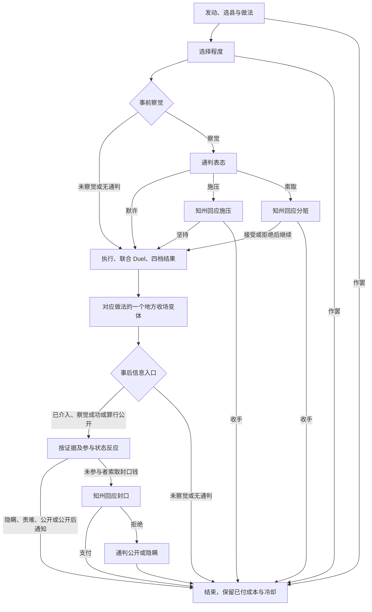

# 私征苛敛

本页维护私征苛敛的机制与事件网。第一版完整设计已经写出，尚未实现、尚未获得数值验收；事件标题与选项为意图草案，不作为最终双语本地化。

- 本页：已议定机制、事件走向与设计取舍。
- [事件情境与组合](events.md)：十八个地方情境、通判前后场面、收场选择的呼应及十二组完整路径示例；不含完整事件正文。
- [首版数值与 AI](balance.md)：全部试行金额、概率、权重及模型示例，是数值的唯一维护位置。新增参数均为设计者提案，不冒充已经逐项议定的结论。
- [实现契约与验证](implementation.md)：原版依据、共享入口、秘密与共同责任、生命周期、验收门槛。

## 目的与边界

表现地方官员利用职权向治下额外征敛，以地方经济受损换取个人即时财富。低俸禄是提高 AI 征敛倾向的因素，不是行为的合法依据，也不是发动条件。

- 面向拥有实际直属领地的地方官员，目标限于其直属领地；不扩展到整个下辖封臣领地。
- 所得进入官员个人金币，不扣国库，不模拟公务经费缺口或赋税任务。
- 行为违法，但不必每次形成原生秘密或公开罪行；手段和程度有轻重，能力影响掩饰与追责结果。
- 复用原生 Duel、压力与灵性满足、Secret、犯罪及权力分享框架。不设腐败值、调查进度或累计暴露值。
- 不引入上级告发事件链、专属量刑、提刑察觉修正、任职年数或临近调任激励。公开后接现有司法机制，不自动执行刑罚。

通判身份、绑定与天平由[通判模块](../tongpan/README.md)拥有；俸禄接口由[官员契约](../office_funding/contracts.md)及其原生来源提供；拘捕权限与审批仍由[地方司法](../judicial/README.md)拥有。本机制不复制另一套身份、官署或权限。

## 已定共同规则

### 发动、冷却与中止

- 正式发动决议即给官员本人施加两年冷却，不跟随目标领地或官职头衔。
- 选择做法时立即支付对应资源成本。后续收手不退费，也不取消冷却。
- 选择做法之前收手，尚未发生做法成本，但已经正式发动时仍保留冷却。
- 收手发生在正式执行之前时，不发放征敛所得，不扣繁荣，不结算执行征敛的心理影响。
- 换任不清除官员冷却，不清除原目标地方已经承担的后果；新任官员不继承前任的个人冷却。

### 收益与地方代价

- 三种做法共用轻、中、重三档基础模型。同一档的基础金币所得与主要地方损失基本一致，差异主要放在做法成本、次要代价和后续即时损失。
- 所得以目标县税赋为经济规模尺度，主要损失按目标当前发展度／未来繁荣度的一部分直接扣减，允许损失已有数值。具体取数、低值边界和三档参数见[首版经济模型](balance.md#经济模型)。
- 本页用“繁荣损失”指上述设计目标，不声称未来繁荣度接口已可用。当前发展度与后续繁荣度的接入方式须按实际游戏版本核对。
- 从地方搜括是经济结算的出发点。收益与地方损失的关系须一起设计，不能凭空创造与地方承受能力无关的收入。
- 重度一次取得更多，在两年冷却下具有更高的单次搜括效率，同时造成更大损失并更难遮掩。
- 不固定扣控制力或民众好感度；根据后续具体情境使用。主要繁荣损失不因掩饰成功而免除。
- 后续退还钱财或支付收场费用属于额外处置支出，不自动恢复已经扣除的主要繁荣损失。

### 地方 modifier

- 本机制附加的限期地方 modifier 统一持续两年，与决议冷却同长。
- 同名不叠加；再次获得时从当次起重新计算两年期限。不同 modifier 可以共存。
- 是否需要先移除再添加，须用独立测试局验证重复添加的实际刷新行为，不预先假定。
- 此规则针对本机制的地方后果，不据此改写原版秘密、犯罪理由或其他原生效果的期限。

### 心理影响

执行时使用原生 `stress_and_fulfillment_impact` 思路，按人物自身特质结算压力与灵性满足；程度越重，原则上影响越大。不以是否被发现为前提。

知州执行征敛、通判实际收取事前分赃或事后封口钱，各自承担心理影响。特质与信仰联动参照原版，不建立独立道德评分体系。首版提案：仅知情、默许或未兑现的索贿不另作收赃心理结算；具体输入见[心理参数](balance.md#心理参数)。

## 做法与程度

不依赖复杂的事前地方情境筛选来投放机会。玩家选择做法和程度，多元情境主要由后续结果事件表现。

### 巧立名目

借地方公务之名额外征取，所得归个人。主要围绕摊派、名目质疑和经手人行为展开。

- 轻：“小额摊派，不必闹出动静。”
- 中：“各户都该有所承担。”
- 重：“既然开征，就不能只取这点。”

### 折纳牟利

利用交纳、折算与收纳过程取利。主要围绕交纳负担、变卖积蓄与经营阻滞展开。

- 轻：“折算之间，略取些余利。”
- 中：“把交纳的条件再收紧些。”
- 重：“让他们设法凑足。”

### 强征勒索

利用官威迫使地方交钱。主要围绕求情、威吓、抗拒与收场展开。

- 轻：“给他们一点暗示。”
- 中：“把我的要求说清楚。”
- 重：“不交，就让他们知道后果。”

三种程度事件均提供作罢选项。即时成本采用威望、影响力的不同配置，具体对应见[做法与政治资源](balance.md#做法与政治资源)。涉及的历史名目仍须按[考证规范](../../research/standards.md)核对，玩法分类本身不是史料结论。

## 设计取舍

- 采用个人私利动机，不引入公务缺口：前者直接联系低俸禄与地方搜括，后者需要当前玩法尚不存在的任务与赤字约束。
- 采用三档共同经济模型与事后情境变体，不建立事前地方机会库：主体数值可一起调整，事件差异由收场与通判反应承担。
- 采用两年个人冷却，不引入累计暴露值：重复征敛本身会重复承担风险；冷却不被换任清除。
- 采用一次管理＋谋略联合 Duel，不分执行与掩饰两套判定；通判察觉只决定介入机会，不修改罪证结果。
- 采用独立私征秘密及原生发现、勒索、公开框架，不直接套用侵吞国库的受害者与揭露叙述；处罚范围尽量照原版，不另建轻重罪量刑体系。

其中秘密类型、数值及实现细节是本轮设计者补齐的提案，原生接入仍有必须通过的引擎验证门槛。

## 事件网

下列编号只用于说明事件走向，不是已经实现的脚本标识。

资格、目标选择、等待期间的状态变更与节点清理见[实现契约](implementation.md#交易上下文与时序)。

### E0：发动与选择做法

选择直属目标并正式发动，施加官员两年冷却。

- 巧立名目／折纳牟利／强征勒索：立即支付各自成本，进入对应 E1。
- 作罢：结束；保留冷却，尚未支付做法成本。

### E1：对应做法的程度选择

- 轻／中／重：固定本次目标、做法与程度，进入事前察觉判定。
- 作罢：结束；不退成本，保留冷却。

无适用通判或未事前察觉，直接进入 E5。察觉则进入 E2。交涉期间不反复切换程度。

### E2：通判事前察觉

- 默许：“此事不宜插手。”进入 E5，记录通判知情但未收赃。
- 劝止或施压：“我要他停止此事。”进入 E3。
- 要求分赃：“既有余利，也该有我的一份。”进入 E4。

天平越偏向通判，原则上越容易察觉，也影响双方敢于施压、索取与妥协的 AI 评分。能力与征敛程度也可影响察觉。天平不直接修改联合 Duel，不自动决定道德立场。

### E3：知州回应施压

- 收手：“既然你坚持，此事便罢。”终止征敛，天平向通判倾斜；成本与冷却保留。
- 坚持：“此事由我作主。”进入 E5，可损害双方关系，天平不自动变化。

通判的反对不额外提高后续暴露概率；其经历改变后续文字、选项与 AI 倾向。第一版不在此反提分赃，避免谈判循环。

### E4：知州回应分赃

- 接受：“有我的，也会有你的。”进入 E5，执行时从本次实际所得中支付约定份额。
- 拒绝并继续：“你休想分走一文。”进入 E5，可损害关系，记录索贿遭拒；不提高暴露概率。
- 收手：“这笔钱，我不取了。”结束，保留成本与冷却。按退出交易处理，暂不自动改变天平。

要求分赃本身不等于共同犯罪；以实际收到钱作为本机制认定参与的条件。

### E5：执行与统一结算

结算三档基础所得与繁荣损失、已答应的分赃、双方对应心理影响，并以管理＋谋略联合 Duel 落定四档结果。程度影响难度；具体联合方式、权重与概率见[联合 Duel](balance.md#联合-duel)。

- **天衣无缝**：不生成秘密，没有因败露产生的额外政治资源损失。做法成本、地方损失和后续处置仍存在。
- **风闻失节**：政治资源损失与非议，不生成犯罪秘密。
- **授人以柄**：政治资源损失，生成犯罪秘密；实际收赃通判有对应共同责任。
- **罪证确凿**：较大政治资源损失，形成公开罪行与合法追责理由；实际收赃通判承担同类罪行。

进入 E6。秘密实际由谁掌握须随知情路线处理，不自动授予所有人物。

### E6：地方收场事件

每次从所属做法的变体中进入一个收场事件。正文结合既定四档结果；选项处理地方余波，不再判定一轮罪证，也不能撤销已经落定的秘密或公开罪行。

发动时不穷举告知未来会出现哪种额外损失；事件实际出现后，应清楚提示当前选项的即时后果。处理后进入 E7。

每种做法的三个家族各有两个具体情境，按[事件情境与组合](events.md)组织；本次选定家族与情境后不因回调、存读档或通判反应重抽。收场选择影响 E8 的衔接场面，不追加概率或隐式效果。

### E7：通判事后入口

- 罪行已经公开：适用通判直接进入公开后反应，不做察觉判定来隐藏公开事实。
- 此前未察觉：独立进行事后察觉判定；未察觉则结束，察觉则进入 E8。
- 此前已介入：不重抽“是否察觉”，按默许、曾反对、索贿遭拒或已分赃身份进入 E8。
- 无适用通判：结束。

事前与事后使用独立事件和判定入口。知情不等于掌握可追责秘密；信息程度服从四档结果，不凭空产生罪证。

秘密获知的接入提案：结果为“授人以柄”时，事前已知情或事后察觉成功的通判取得知州对应秘密，不再追加一轮罪证概率。收赃双方互相掌握对应参与秘密；具体契约见[秘密与罪行](implementation.md#秘密与罪行)。不能仅记录事件知情状态而遗漏原生秘密知情者，也不能把本提案写成已验证的引擎行为。

### E8：通判事后反应

**无可用犯罪秘密：天衣无缝／风闻失节。**

- 就此作罢：结束。
- 私下责难知州：关系后果，结束。

不得公开不存在的秘密，不进入以罪证索取封口钱的路线。

**掌握秘密、尚未收赃：授人以柄。**

- 隐瞒不发：保留秘密，结束。
- 公开秘密：接原生揭露，结束。
- 索取封口钱：进入 E9。

**已经分赃、留下秘密。**

- 共同隐瞒：秘密保留，结束。
- 与知州决裂，公开秘密：接原生公开处理，不给予通判自动免责。首版使用本次共同犯罪的关联公开，使双方一起承担后果；具体防递归与独立秘密去重规则见[实现契约](implementation.md#秘密与罪行)。

第一版不再索取第二份分赃。

**罪行已经公开。**

未参与者可责难或保持距离；参与者收到共同败露的对应事件。之后由原生犯罪与现有司法处理，不提供花钱阻止首次公开或撤销罪行的选项。

### E9：知州回应封口要求

- 支付：“拿了钱，就管住你的嘴。”从本次尚未分出的所得中支付，且个人金币必须实际足够。通判收钱后承担同类秘密与共同责任，本次选择沉默；不删除秘密，不保证其他知情者沉默。
- 拒绝：“我不会再给你一文。”进入 E10。

本次总分赃不得超过本次所得，不凭空增发金币。此前已参与者不再进入本次封口交易。

### E10：索取遭拒后的最后回应

- 公开秘密：接原生揭露，结束。
- 暂且隐瞒：保留秘密，结束。

无第二轮报价，不反复触发本次封口要求；以后继续使用原生秘密发现、勒索与揭露机制。

## 地方收场变体

三种做法仍分别使用摊派／名目／经手人、积蓄／商户／收纳、求情／冲突／停业三个家族。具体情境与选项意图统一维护在[事件内容页](events.md)，效果与成本统一维护在[收场参数](balance.md#地方收场参数)，避免重复维护。

本地情境可与四档结果、通判经历及收场选择组合，但不额外生成富户／胥吏人物、真实囚犯或独立地方组织，也不为了表现多样性新增一套调查流程。

## 秘密、罪行与共同责任

- 事前实际分赃与事后实际接受封口钱均构成参与；知州与通判承担同类秘密和罪行，不另设较轻的通判罪名。
- 单纯知情、默许、未兑现的索贿要求，不由本机制自动认定为共同犯罪。
- 尽量沿用原生发现、勒索、公开与追责框架，不引入向上级告发的专属路线。
- 参照原版侵吞国库，保留拘捕、处决、驱逐理由；不额外赋予未核对的撤职／撤销头衔理由。
- 合法理由不等于自动处罚，不替代实际发起人的权限、司法审批或原生执行过程。轻度征敛公开后也可能具有处决理由，是当前统一框架的明确简化；以后若扩展罪行轻重再统一调整。

原版侵吞国库的有效性、揭露叙述与私征不同，首版提案使用独立私征秘密与罪行对象，保留原版框架及处罚范围。完整来源、合法理由接收人、关联公开、防重与接口限制统一维护在[秘密与罪行](implementation.md#秘密与罪行)。源码参考不等于已通过引擎验证。

## AI 设计方向

- 是否发动：个人财富与债务、贪婪、荣誉、胆量、预计心理影响、灵性满足，以及皇帝制定的俸禄比例。俸禄越低总体倾向越高，不使用征敛所得与个人俸禄的比值。
- 目标与程度：税赋收益、个人资金需求、性格、管理与谋略能力。
- 做法与收场：可支付资源、个性与愿意承担的地方后果；不得所有 AI 无条件选择同一最低成本做法。
- 通判：人格、双方关系、个人利益、天平及此前经历；正直者偏向劝止或揭露，贪婪者偏向分赃，但不设绝对特质限制。
- 分赃后共同风险应影响后续选择，不赋予揭发后的自动免责。

## 当前状态与验收边界

事件网、参数、AI 评分、边界处理与接口方案均已形成首版设计；新增细节是可审阅提案。尚未实现或运行引擎测试。

下一步实现前必须核对的接口、失败时的停止条件、定向用例与人工验收，统一见[实现契约与验证](implementation.md)。数值单调性与数学示例不替代原生 Duel、真实决议、动态文本、自然 AI、秘密发现／勒索／公开、司法及保存重载验收。
